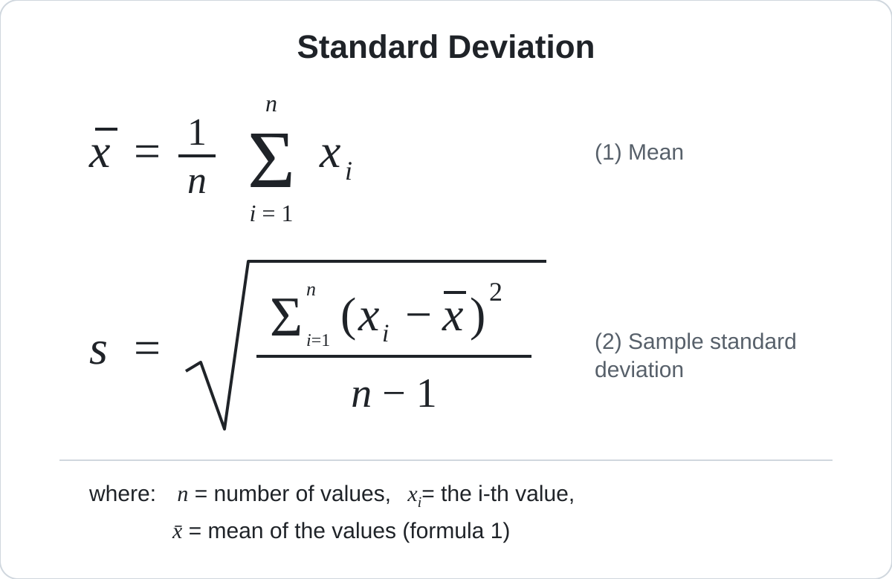

# Learning Assessment: Standard Deviation in Java

## Purpose

This exercise assesses your ability to turn a mathematical definition into a working, well-structured Java program. It covers reading input from a file, validating data, implementing a statistical calculation correctly, and presenting the result visually.

You are expected to design and write the program yourself. This document describes **what** must be built, not **how** to build it.

## The Problem

Write a Java program that reads a list of **n** numbers from a text file, calculates their **standard deviation**, and shows a **chart** of the result.

## The Formula

The standard deviation measures how far the values in a data set are spread out from their mean. A small standard deviation means the values are close to the mean; a large one means they are widely dispersed.

Your program must use the **sample standard deviation**, computed in two steps: first the mean (1), then the standard deviation (2).

## Input

- The numbers are stored in a plain text file.
- The values are separated by commas.
- The values may be integers or decimals, positive or negative.
- The program receives the path of the file when it starts.

## Example

Input file with 20 values:

12.45, 18.73, 9.86, 21.04, 15.37, 11.92, 17.58, 23.61, 14.29, 19.95, 10.48, 16.83, 22.17, 13.66, 20.39, 8.74, 17.12, 14.98, 24.56, 11.35

Expected result, rounded to 4 decimal places:

| Output | Expected value |
|---|---|
| Number of values (*n*) | 20 |
| Mean (*x̄*) | 16.2540 |
| Sample standard deviation (*s*) | 4.7112 |

## Requirements

1. Read the numbers from the input file.
2. Calculate the mean and the sample standard deviation exactly as defined by the formula above.
3. Print to the console the number of values (*n*), the mean, and the standard deviation. The mean and the standard deviation must be rounded to a maximum of 4 decimal places.
4. Display a chart that shows the data values together with the mean and the spread defined by the standard deviation, so that a reader can see which values fall within one standard deviation of the mean and which do not.
5. Handle invalid situations with a clear message instead of crashing. Think about what can go wrong with the input file and with the formula itself.
6. Write the program in Java (version 17 or later).

## Deliverables

1. The Java source code, organized and readable.
2. The input files you used to test your program, including at least one that is valid and others that exercise the invalid situations you identified.
3. A screenshot or image file of the chart produced for a valid input.
4. A short write-up (one page at most) explaining:
   - how you checked that your results are correct;
   - the invalid situations you identified and how your program responds to each one;
   - any defects you found while building the program, and how you fixed them.

## Evaluation Criteria

| Criterion | What is evaluated |
|---|---|
| Correctness | The results match the formula for every valid input, including the example, and are rounded to 4 decimal places. |
| Robustness | Invalid input is detected and reported clearly. |
| Visualization | The chart communicates the mean and the dispersion of the data. |
| Code quality | Structure, naming, readability, and separation of responsibilities. |
| Verification | Evidence that you tested your program and how. |
| Communication | Clarity and honesty of the write-up. |