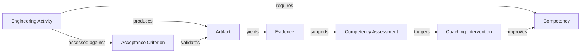

# SECAV-O

Software Engineering Coaching and AI Validation Ontology / Coaching Lifecycle, Planning, Risk, Alignment and Ethics Artifacts

> Current version: v0.3.0
>
> SECAV-O is an ontology-supported framework for software-engineering coaching, observable evidence, AI-assisted validation, human review, competency development, and governance.

This repository extends the core SECAV-O ontology with a coaching governance layer covering:

- team coaching from inception through launch and onboarding
- annual and sprint planning
- risk management with preventive and corrective actions
- institutional alignment and project planning participation
- ethics and coach accountability
- quality advocacy, dissent, and escalation

## Table of contents

- [Overview](#overview)
- [Repository structure](#repository-structure)
- [Core ontology and validation](#core-ontology-and-validation)
- [Governance and operating model](#governance-and-operating-model)
- [Templates and examples](#templates-and-examples)
- [Learning exercises](#learning-exercises)
- [Citing the project](#citing-the-project)
- [License](#license)

## Overview

SECAV-O connects software-engineering activities, artifacts, competencies, evidence, AI assistance, human validation, and coaching interventions in a single conceptual model. The framework is designed to support real engineering work, observable improvement, and accountable coaching decisions without reducing quality to abstract metrics alone.

The repository includes:

- the core ontology and SHACL validation rules
- governance guides for coaching operations and quality assurance
- templates for planning, risk management, and assessment
- worked examples and machine-readable schemas
- learning exercises and example records

## Repository structure

```text
SECAV-O/
├── CHANGELOG.md
├── CITATION.cff
├── LICENSE
├── readme.md
├── coaching-governance/
│   ├── docs/
│   ├── glossary/
│   └── guides/
├── examples/
├── exercises/
├── ontology/
├── pilot/
├── schemas/
├── templates/
├── validation/
└── .github/
```

## Core ontology and validation

The ontology layer is the backbone of the framework.

- [`ontology/secav-o.ttl`](ontology/secav-o.ttl) — core SECAV-O ontology
- [`ontology/secav-o-coaching-governance-extension.ttl`](ontology/secav-o-coaching-governance-extension.ttl) — coaching-governance extension
- [`validation/secav-o.shacl.ttl`](validation/secav-o.shacl.ttl) — SHACL validation for the core ontology
- [`validation/secav-o-coaching-governance.shacl.ttl`](validation/secav-o-coaching-governance.shacl.ttl) — validation for the governance extension

These files model engineering activities, artifacts, competencies, evidence, measurement, coaching interventions, review outcomes, AI assistance, and human validation.

### Example ontology view

This diagram illustrates the core conceptual pattern used throughout SECAV-O:



The intent is to keep coaching tied to actual engineering work, actionable evidence, and competency growth instead of treating metrics or opinions as substitutes for observed outcomes.

## Governance and operating model

The governance material defines how coaching works in practice across teams, plans, risks, ethics, and quality decisions.

### Operating model documents

- [`coaching-governance/docs/coaching-cycle.md`](coaching-governance/docs/coaching-cycle.md)
- [`coaching-governance/docs/team-coaching-lifecycle.md`](coaching-governance/docs/team-coaching-lifecycle.md)
- [`coaching-governance/docs/project-planning-participation.md`](coaching-governance/docs/project-planning-participation.md)
- [`coaching-governance/docs/institutional-alignment.md`](coaching-governance/docs/institutional-alignment.md)
- [`coaching-governance/docs/metrics-model.md`](coaching-governance/docs/metrics-model.md)
- [`coaching-governance/docs/competency-growth-scale.md`](coaching-governance/docs/competency-growth-scale.md)
- [`coaching-governance/docs/ontology-alignment.md`](coaching-governance/docs/ontology-alignment.md)

### Governance guides

- [`coaching-governance/guides/minimum-quality-criteria.md`](coaching-governance/guides/minimum-quality-criteria.md)
- [`coaching-governance/guides/robust-process-criteria.md`](coaching-governance/guides/robust-process-criteria.md)
- [`coaching-governance/guides/requirements-inspection.md`](coaching-governance/guides/requirements-inspection.md)
- [`coaching-governance/guides/peer-review-sessions.md`](coaching-governance/guides/peer-review-sessions.md)
- [`coaching-governance/guides/formal-inspections.md`](coaching-governance/guides/formal-inspections.md)
- [`coaching-governance/guides/risk-management.md`](coaching-governance/guides/risk-management.md)
- [`coaching-governance/guides/defect-tracking.md`](coaching-governance/guides/defect-tracking.md)
- [`coaching-governance/guides/code-review-best-practices.md`](coaching-governance/guides/code-review-best-practices.md)
- [`coaching-governance/guides/ai-assisted-code-review.md`](coaching-governance/guides/ai-assisted-code-review.md)

### Glossary

- [`coaching-governance/glossary/glossary.md`](coaching-governance/glossary/glossary.md) — authoritative definitions for the concepts used in the framework

## Templates and examples

- [`templates/annual-coaching-plan.md`](templates/annual-coaching-plan.md)
- [`templates/coaching-sprint-plan.md`](templates/coaching-sprint-plan.md)
- [`templates/engineer-development-record.md`](templates/engineer-development-record.md)
- [`templates/coach-meeting-minutes.md`](templates/coach-meeting-minutes.md)
- [`templates/risk-register.csv`](templates/risk-register.csv)
- [`templates/defect-log.csv`](templates/defect-log.csv)
- [`templates/metrics-register.csv`](templates/metrics-register.csv)
- [`examples/design-review.ttl`](examples/design-review.ttl)
- [`examples/example-coaching-sprint.yaml`](examples/example-coaching-sprint.yaml)
- [`examples/example-engineer-development-record.md`](examples/example-engineer-development-record.md)

## Learning exercises

- [`exercises/java-standard-deviation/README.md`](exercises/java-standard-deviation/README.md)
- [`examples/java-standard-deviation-exercise.ttl`](examples/java-standard-deviation-exercise.ttl)

## Citing the project

If you use SECAV-O in research, training, or practice, cite the repository metadata in [`CITATION.cff`](CITATION.cff).

## License

This project is licensed under the [MIT License](LICENSE).
